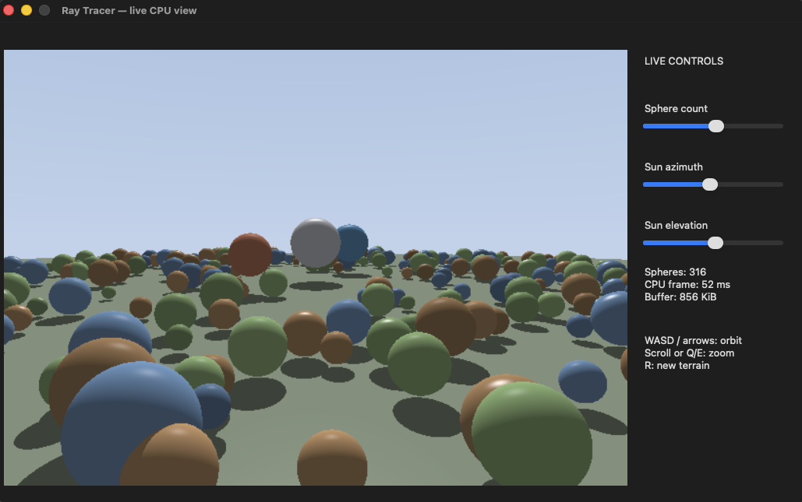

# Parallel Sphere Ray Tracer

A compact CPU ray tracer written in **C++17**. It renders a scene made entirely of spheres, distributes rendering work across CPU threads, and includes a native macOS live viewer for orbiting the camera, zooming, moving the sun, and changing the sphere count.




## Requirements

- macOS with Apple's Command Line Tools installed (`xcode-select --install`)
- C++17 compiler (Apple Clang is used by the Makefile)

The project has no third-party runtime or graphics-library dependency. The live viewer uses the Cocoa framework included with macOS.

## Run the project

```bash
cd ray-tracing

# Build the parallel offline renderer.
make

# Create a default 800 x 600 PPM still.
./raytracer --output output.ppm

# Build and open the real-time macOS viewer.
make live
./raytracer-live
```

The offline renderer writes a binary PPM (`P6`). Convert it to PNG with ImageMagick if installed:

```bash
magick output.ppm output.png
```

### Offline options

```bash
./raytracer --width 1280 --height 720 --samples 16 --spheres 180 --threads 4 --output scene.ppm
```

| Option | Purpose |
| --- | --- |
| `--width`, `--height` | Image dimensions, bounded to 64–4096 pixels per side. |
| `--samples` | Rays per pixel; higher values improve anti-aliasing but take longer. |
| `--spheres` | Number of generated scene spheres, capped at 600. |
| `--threads` | Number of CPU workers; omit it to use hardware concurrency. |
| `--output` | PPM output path; omit it to write image data to standard output. |

### Live viewer controls

| Input | Action |
| --- | --- |
| `W` `A` `S` `D` or arrow keys | Orbit the camera. |
| Scroll, `Q`, `E` | Zoom out/in. |
| `R` | Generate a new sphere layout. |
| Side-panel sliders | Change sphere count and the sun's azimuth/elevation. |

The viewer renders a 640 x 448 RGB buffer and scales it to its window. The framebuffer is under 1 MiB; the sphere scene adds only a few KiB, so it is suitable for systems with less than 8 GB of RAM.

## How the renderer works

### Rays and camera

Every pixel becomes a ray from the orbit camera through the virtual view plane. The direction is normalized so intersection distance has a consistent meaning.

```cpp
rt_vec3 position = camera.target + rt_vec3(cy * cp, sp, sy * cp) * camera.distance;
rt_vec3 forward = rt_unit(camera.target - position);
rt_vec3 direction = rt_unit(forward + right * u + up * v);
```

The live controls update `yaw`, `pitch`, and `distance`, then the next frame casts rays from the new camera position.

### Ray–sphere hits

For each sphere, the renderer substitutes the ray equation into the sphere equation and solves the resulting quadratic. A negative discriminant means the ray misses. The nearest valid root becomes the visible hit.

```cpp
float discriminant = half_b * half_b - a * c;
if (discriminant < 0.0f) continue;

float root = (-half_b - std::sqrt(discriminant)) / a;
if (root <= min_t || root >= max_t) {
    root = (-half_b + std::sqrt(discriminant)) / a;
}
```

The hit point and unit surface normal are then used by lighting and shadow tests.

### Direct sunlight and shadows

Real-time mode uses one ray for visibility plus one shadow ray toward the sun. This is intentionally cheaper than recursive path tracing and keeps movement responsive.

```cpp
RtRay shadow = { rec.point + rec.normal * 0.002f, settings_.sun_direction };
bool blocked = hit(shadow, 0.001f, 1e30f, blocker);
float diffuse = std::max(0.0f, rt_dot(rec.normal, settings_.sun_direction));
float light = 0.16f + (blocked ? 0.0f : 0.84f * diffuse);
```

The small normal offset avoids a surface incorrectly shadowing itself. Missed rays blend into a sky gradient.

### Parallel rendering

Rendering dynamically assigns rows to worker threads. This balances expensive and inexpensive rows without sharing random-number state between workers.

```cpp
std::atomic<int> next_row(0);
for (unsigned worker = 0; worker < workers; ++worker) {
    pool.emplace_back([this, &camera, &next_row, worker] {
        uint32_t seed = 0x9e3779b9u ^ (worker * 0x85ebca6bu);
        for (;;) {
            int y = next_row.fetch_add(1, std::memory_order_relaxed);
            if (y >= settings_.height) return;
            renderRow(y, camera, seed);
        }
    });
}
```

The default worker count is `std::thread::hardware_concurrency()`. Use `--threads` to compare a fixed worker count or reserve CPU capacity for other work.

## Benchmarking

Build and run the reproducible low-memory benchmark:

```bash
cd ray-tracing
make benchmark
```

It renders a 640 x 420 frame with 8 samples per pixel and 120 generated spheres, reports wall-clock time, writes its temporary image outside the repository, then removes it. For comparisons, keep resolution, samples, sphere count, compiler flags, and power mode unchanged. Expected cost grows roughly with:

`width × height × samples × spheres × visible-ray/shadow-ray work`

As a reference only, this benchmark completed in **0.41 seconds** on the current M3 MacBook Air. Hardware, thermal state, and selected worker count change the result, so use your own run as the meaningful comparison.

The live view uses one sample and a lower internal resolution, so it is a responsiveness benchmark rather than a substitute for the offline quality benchmark.

## Source layout

| File | Role |
| --- | --- |
| `ray-tracing/realtime_renderer.h` | Sphere geometry, camera math, ray casting, lighting, pixel buffer, and parallel row scheduler. |
| `ray-tracing/main.cpp` | Offline CLI renderer and PPM writer. |
| `ray-tracing/interactive.mm` | Cocoa live-view window, camera input, and lighting/sphere controls. |
| `ray-tracing/Makefile` | Repeatable build and benchmark commands. |
| `LICENSE` | Open-source license. |

## Cleaning build products

```bash
cd ray-tracing
make clean
```

This removes only the executables built by the Makefile. It does not delete your rendered images.
